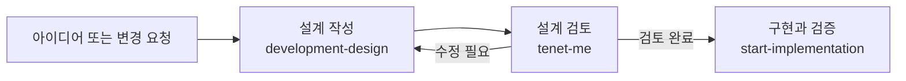

# Emeth

Emeth는 코딩 에이전트가 요청받은 작업 범위를 끝까지 지키고, 직접 확인한 결과를 바탕으로 완료 여부를 보고하도록 돕는 플러그인입니다. Codex, Claude Code, Mixdog을 지원합니다.

작업이 길어지면 처음 요청의 세부 조건을 빠뜨리거나, 확인하지 않은 부분까지 끝났다고 보고하기 쉽습니다. 대화 중 발견한 버그나 후속 작업도 다음 작업으로 이어지지 않고 잊히곤 합니다. Emeth는 대화에 적용할 공통 기준과 작업별 스킬, 프로젝트에 남는 기록으로 이런 누락을 줄입니다.

## ✨ 주요 기능

- **대화와 결과물 품질 관리**: 요청한 범위와 수정 권한을 지키고, 확인한 근거를 바탕으로 결과를 보고합니다.
- **기획부터 구현까지**: 아이디어를 기획서와 구현 명세로 정리하고, 구현·검증으로 이어갑니다.
- **코드 이해와 후보 비교**: 코드의 동작과 설계 이유를 설명하고, 독립 후보를 비교해 결과를 개선합니다.
- **리팩터링과 코드 이식 검증**: 실제 구조가 바뀌었는지, 원본 동작이 보존됐는지 확인합니다.
- **프로젝트 기록 관리**: 이슈, 기획서, 구현 명세를 파일로 남겨 다음 작업에서 참고합니다.
- **아키텍처 관리**: 프로젝트 구조와 설계 결정, 운영 제약을 기록·갱신하고 설계·구현·검토에 활용합니다.
- **통합 대시보드**: 여러 프로젝트의 작업 기록과 아키텍처 문서를 로컬 웹 화면에서 확인합니다.

## 📊 벤치마크

SuperJSON의 Error 스택 직렬화 작업을 같은 요구 사항으로 실행한 결과입니다.

- **None**: 플러그인 미사용
- **Core**: 플러그인 활성화
- **Workflow**: [`$emeth-discipline:figure-it-out`](plugins/emeth-discipline/skills/figure-it-out/SKILL.md) 호출

| 모델 | 조건 | 공식 외부 검사 | 추가 진단 | 시간 | 비교용 추정 비용 |
| --- | --- | ---: | ---: | ---: | ---: |
| 6 Astra low | None | 196/196 | 3/14 | 4분 57초 | $0.973 |
| 6 Astra low | Core | 196/196 | 5/14 | 4분 23초 | $0.929 |
| 6 Astra low | Workflow | 196/196 | 7/14 | 7분 54초 | $1.990 |
| 6 Astra low | Workflow (한 세션) | 196/196 | 4/14 | 6분 43초 | $1.611 |
| 6.1 Sol medium | Core (1회) | 196/196 | 6/14 | 5분 34초 | $0.309 |
| 6.1 Sol medium | Workflow (기본) | 196/196 | 7/14 | 8분 39초 | $0.914 |
| 6.1 Sol medium | Workflow (확장) | 196/196 | 9/14 | 9분 27초 | $1.131 |


[측정 조건과 회차별 결과](docs/benchmarks/README.md)

## 📦 설치

### Codex CLI에서 설치

`emeth-discipline` 마켓플레이스를 추가한 다음 Emeth 플러그인을 설치합니다.

```bash
codex plugin marketplace add semisemil/emeth-discipline
codex plugin add emeth-discipline@emeth-discipline
codex
```
Codex가 열리면 다음 순서로 마무리합니다.

1. `/hooks`를 엽니다.
2. Emeth의 `SessionStart`, `SubagentStart`, `UserPromptSubmit` 훅을 확인하고 승인합니다.
3. 새 작업을 시작합니다.

훅 파일 경로가 바뀐 버전으로 업데이트한 경우에도 `/hooks`에서 현재 정의를 확인하고 승인합니다.

대시보드 최초 등록에는 프로젝트 밖의 저장 폴더에 쓰기 권한이 필요합니다. [저장 위치와 권한 설정](#대시보드-저장-위치와-권한-설정)을 참고하세요.

### Claude Code에서 설치

Claude Code에서 마켓플레이스를 추가한 다음 플러그인을 설치합니다.

```text
/plugin marketplace add semisemil/emeth-discipline
/plugin install emeth-discipline@emeth-discipline
```

## 🚀 빠르게 사용하기

### 기본 지침

Emeth의 `Rules` 스킬에 담긴 기본 지침은 새 작업을 시작하거나 `/clear`, `/compact`를 실행할 때 자동으로 불러옵니다. 기존 작업을 재개할 때(`resume`)는 공통 기준을 다시 불러오지 않지만, 대시보드 서버 확인과 아키텍처 메모리 연결 훅은 실행됩니다. 하위 에이전트에도 `SubagentStart` 훅으로 공통 기준을 전달합니다.

Codex에서 특정 요청에 공통 기준을 명시하려면 스킬 이름을 적으세요.

```text
$emeth-discipline:rules
이 문서를 처음 읽는 사람도 이해할 수 있게 고쳐줘.
```

## 🧩 포함된 스킬

### 공통 규칙과 작업 관리

공통 품질 기준, 작업 검증, 이슈 기록과 대시보드를 담당합니다.

| 스킬 | 이런 때 사용합니다 | 하는 일 |
| --- | --- | --- |
| `$emeth-discipline:rules` | 대화와 결과물 전반 | 명확한 표현, 요청 범위, 수정 권한, 판단 근거 확인 |
| `$emeth-discipline:scope-integrity` | 규모가 크거나 위험하고 여러 단계로 진행되는 작업 | 요청한 목표·필수 조건·완료 기준 유지, 임의 누락·축소 방지 |
| `$emeth-discipline:refactor-proof` | 책임, 의존 관계, 호출 구조, 상태 흐름을 바꾸는 리팩터링 | 실제 구조 변경과 기존 동작 보존 여부 검증 |
| `$emeth-discipline:exact-port` | 원본 동작을 그대로 옮겨야 하는 코드 이식 | 원본과 대상 비교, 사용자에게 승인받은 차이와 미확인 부분 기록 |
| `$emeth-discipline:issue-ledger` | 버그나 후속 작업을 프로젝트에 남길 때 | 현재 상태, 다음 조치, 완료 조건, 결정과 검증 근거 기록 |
| `$emeth-discipline:dashboard-server` | 통합 대시보드를 이용할 때 | 현재 프로젝트 등록, 실행 중인 대시보드 열기·상태 확인·종료 |

### Architecture

프로젝트 구조를 함께 설계하고, 배경과 주요 결정을 기록하거나 참고합니다.

| 스킬 | 이런 때 사용합니다 | 하는 일 |
| --- | --- | --- |
| `$emeth-discipline:architecture-coop` | 새 아키텍처를 설계하거나 기존 구조를 재설계할 때 | 추천안과 질문을 먼저 제시하고, 전체 방향을 유지하며 구조를 함께 완성 |
| `$emeth-discipline:architecture-memory-init` | 기존 프로젝트 전반을 먼저 분석하고 싶을 때 | 코드와 기존 문서를 바탕으로 구조·제약·결정 정리 |
| `$emeth-discipline:architecture-memory` | 프로젝트 배경을 참고하거나 새로 결정한 내용을 남길 때 | 관련 문서 검색, 사용자 결정과 운영 환경 기록 |
| `$emeth-discipline:architecture-memory-update` | 커밋된 코드 변경을 아키텍처 문서에 반영할 때 | 마지막 확인 커밋 이후의 변경 검토와 문서 갱신 |

### Workflow

기획부터 기술 설계까지 하나의 Design으로 발전시키고, 검토와 구현으로 이어갑니다.

| 스킬 | 이런 때 사용합니다 | 하는 일 |
| --- | --- | --- |
| `$emeth-discipline:development-design` | 개발설계문서를 작성하거나 수정할 때 | 작업에 맞는 문서 형식으로 개요와 상세 설계를 여러 파일에 연결해 작성 |
| `$emeth-discipline:tenet-me` | 설계나 구현이 요구 결과를 보장하는지 검토할 때 | 결과에서 필요한 조건과 근거를 역추적하고, 발견한 빈틈을 정방향 사례로 확인 |
| `$emeth-discipline:figure-it-out` | 필요한 설계부터 구현까지 맡길 때 | Design 준비와 검토 후 구현과 검증까지 진행 |
| `$emeth-discipline:start-implementation` | 준비된 설계를 구현할 때 | 기능 개발, 버그 수정, 리팩터링에 맞는 절차로 구현 조율과 검증 |

### 코드 이해와 후보 비교

| 스킬 | 이런 때 사용합니다 | 하는 일 |
| --- | --- | --- |
| `$emeth-discipline:code-exploration` | 코드의 동작과 설계 이유를 이해하거나 배우고 싶을 때 | 질문에 맞춰 how, why, teach 모드로 코드와 변경 이력을 조사하고 설명 |
| `$emeth-discipline:ensemble` | 설계나 구현에 여러 후보를 비교하고 싶을 때 | 독립 후보 생성, 교차 평가, 좋은 부분의 합성, 결과 검증 |

## 🔁 기획부터 구현까지

`figure-it-out`을 호출하면 필요한 설계부터 구현과 검증까지 이어갑니다.
각 단계의 스킬을 따로 호출할 수도 있습니다.



**Design**은 개발할 대상과 설계, 검증 기준을 담는 문서 묶음입니다.

## 🗂️ 이슈 기록

`issue-ledger`는 버그, 일반 작업, 기능, 조사, 문서화, 유지보수 항목을 프로젝트에 저장합니다.

```text
$emeth-discipline:issue-ledger
설정 파일 호환성 문제를 이슈로 등록해줘.
```

```text
$emeth-discipline:issue-ledger
PL-0012의 진행 상황과 확인 근거를 갱신해줘.
```

처음 이슈를 등록하면 다음 구조가 만들어집니다.

```text
.emeth/
  STATE.md
  issues/
    PL-0001.json
```

이슈마다 JSON 파일 하나에 현재 상태, 다음 조치, 완료 조건, 결정과 검증 근거를 저장합니다. 상세 로그나 실험 보고서는 별도 파일로 연결합니다.
Design의 개요는 기본적으로 `.emeth/designs/<DESIGN-ID>-<이름>/DESIGN.md`에 저장하고, 주제별 상세 설계는 같은 디렉터리의 별도 Markdown 파일로 연결합니다.
이슈를 지정하면 관련 작업을 연결할 수 있습니다.

### 문서 저장 경로

기본 저장 위치는 다음과 같습니다.

| 문서 | 위치 |
| --- | --- |
| 아키텍처 | `docs/architecture/` 또는 이미 연결한 폴더 |
| 개발 설계 | `.emeth/designs/` |
| 이슈 | `.emeth/issues/` |

아키텍처와 개발 설계를 다른 폴더에 저장하려면 프로젝트의 `.emeth/documents.json`에 경로를 지정하세요.

```json
{
  "schema_version": 1,
  "root": "D:/Obsidian/projects/my-project"
}
```

이 예시는 지정한 폴더 아래의 architecture/와 designs/에 각각 저장합니다.
각 폴더를 따로 정하려면 `root` 대신 `architecture`와 `designs`에 경로를 지정하세요.
상대 경로는 프로젝트 폴더를 기준으로 합니다.
기존 문서는 직접 옮긴 뒤 설정을 바꾸세요.

## 🏛️ 아키텍처 메모리

아키텍처 메모리는 프로젝트 구조, 운영 환경, 제약, 주요 결정과 그 이유를 Markdown 문서로 관리합니다. 첫 Design 저장부터 작은 Memory가 시작됩니다. 기존 프로젝트 전반의 분석이 필요하면 선택적으로 init을 요청합니다.

```text
$emeth-discipline:architecture-memory-init
```

기본 위치는 `docs/architecture/`입니다. 코드·기존 문서·현재 대화를 바탕으로 프로젝트 구조와 설계 결정, 운영 제약을 정리합니다.

첫 Design 저장 또는 초기화에 성공하면 `.emeth/architecture.json`에 문서 위치를 저장합니다. 이후 이 연결이 있는 프로젝트에서만 훅을 통해 메모리 스킬을 안내합니다. 개발 판단에 필요한 부분을 검색해 읽고, 앞으로도 참고할 결정이나 운영 정보가 생기면 관련 문서에 반영합니다. 일반 프로젝트 대화의 중요한 맥락도 기록합니다. 출처·범위·확정 여부를 보존하고, 읽기 전용 또는 기록 금지 요청에서는 문서를 수정하지 않습니다. 프로젝트 설정의 `enabled: false`나 비활성 Memory도 유지합니다.

커밋된 코드 변경을 문서에 반영하려면 별도로 갱신을 요청합니다.

```text
$emeth-discipline:architecture-memory-update
```

Design의 상태만 바꿀 때는 Memory 연결 상태를 조회하며 초기화를 재시도하지 않습니다. 초기화 실패를 해결한 뒤 Design을 다시 저장하거나 Memory 초기화를 명시적으로 실행하면 연결을 재시도할 수 있습니다.

훅을 지원하지 않는 환경에서는 `architecture-memory`를 직접 호출할 수 있습니다.

## 🖥️ 통합 대시보드

대시보드는 `127.0.0.1`에서 실행되는 로컬 서버입니다. 홈(`/`)에서 작업 기록(`/dashboard`)과 아키텍처 문서(`/architecture`)를 선택하고, 등록된 프로젝트를 전환해 볼 수 있습니다. 아키텍처 화면은 문서와 마지막 확인 커밋, Mermaid 다이어그램을 읽기 전용으로 표시합니다.

이슈·Design 또는 기존 문서를 저장하거나 아키텍처 메모리를 초기화하면 해당 프로젝트를 등록합니다. 서버는 `SessionStart` 훅이 상태를 확인해 시작합니다. 별도 서버 패키지를 설치할 필요는 없습니다.

| 명령 | 동작 |
| --- | --- |
| `$emeth-discipline:dashboard-server add` | 현재 폴더에 `.emeth/`이 있으면 프로젝트 등록 |
| `$emeth-discipline:dashboard-server open` | 실행 중인 서버를 확인하고 대시보드 열기. 서버가 중지되어 있으면 시작하지 않음 |
| `$emeth-discipline:dashboard-server status` | 실행 주소, 서버 식별 정보, 버전 또는 중지 원인 확인 |
| `$emeth-discipline:dashboard-server stop` | 실행 상태와 실제 서버가 일치하는지 확인한 뒤 종료. 프로젝트 등록은 유지 |

프로젝트가 목록에 없으면 해당 프로젝트 폴더에서 `add`를 호출하세요. 이 명령은 프로젝트 파일을 새로 만들거나 다른 폴더를 검색하지 않습니다.

### 대시보드 저장 위치와 권한 설정

프로젝트 목록과 서버 상태는 공용 폴더에 저장합니다.
Windows에서는 `%APPDATA%\emeth\dashboard`를 사용합니다.
다른 운영체제에서는 `$XDG_CONFIG_HOME/emeth/dashboard`를 사용하며, `XDG_CONFIG_HOME`이 없으면 `~/.config/emeth/dashboard`를 사용합니다.

등록 코드는 필요한 저장소를 자동으로 만들고, 이미 등록된 프로젝트는 `no-op`으로 처리합니다.
등록 결과가 `registered` 또는 `no-op`이면 추가 설정 확인 없이 완료합니다.
실제 권한 오류가 발생하면 Codex가 쓰기 권한을 확인하고, 필요하면 안내 후 사용자 `config.toml` 또는 권한 프로필을 수정합니다.
변경된 권한이 현재 작업에 반영되지 않으면 새 Codex 작업에서 등록을 재시도하세요.
권한 설정이 끝나지 않아도 이미 저장한 프로젝트 문서는 유지됩니다.

권한 오류(`EPERM`, `EACCES`)가 나거나 수동 설정이 필요하면 [상세 설정 절차](plugins/emeth-discipline/skills/dashboard-server/references/sandbox-setup.md)를 참고하세요.

## ✅ 개발 검증

저장소 루트에서 전체 테스트를 실행합니다. 별도 패키지 설치는 필요하지 않습니다.

```bash
npm test
```

Codex와 Mixdog의 실제 로더·훅·요청 전달·대시보드 경로를 검증하는 명령은 [호스트 검증](docs/host-validation.md)을 참고하세요.

## 라이선스

[MIT](LICENSE)
